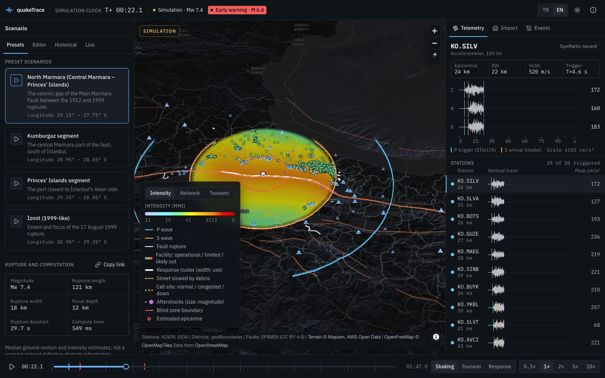
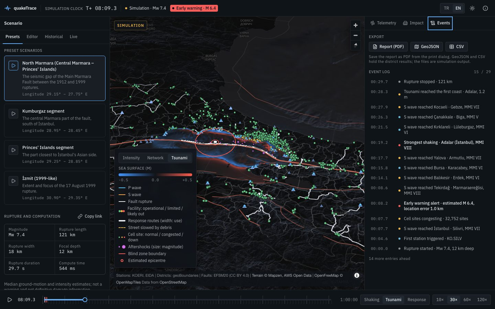
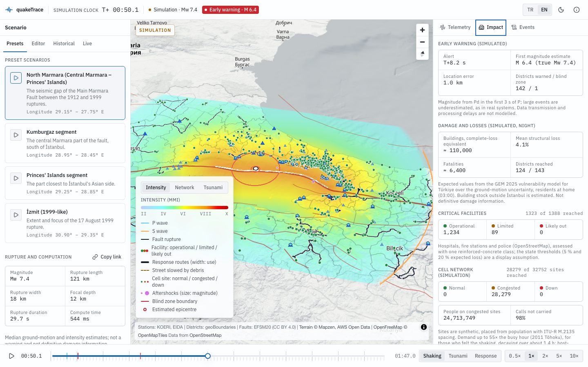
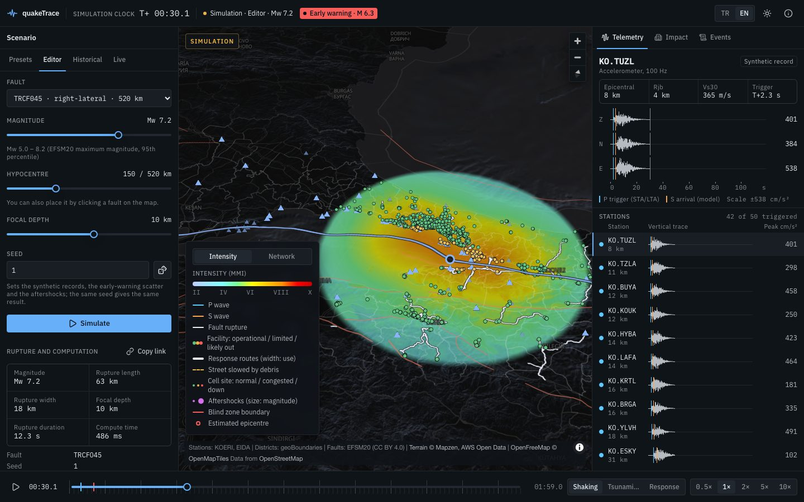
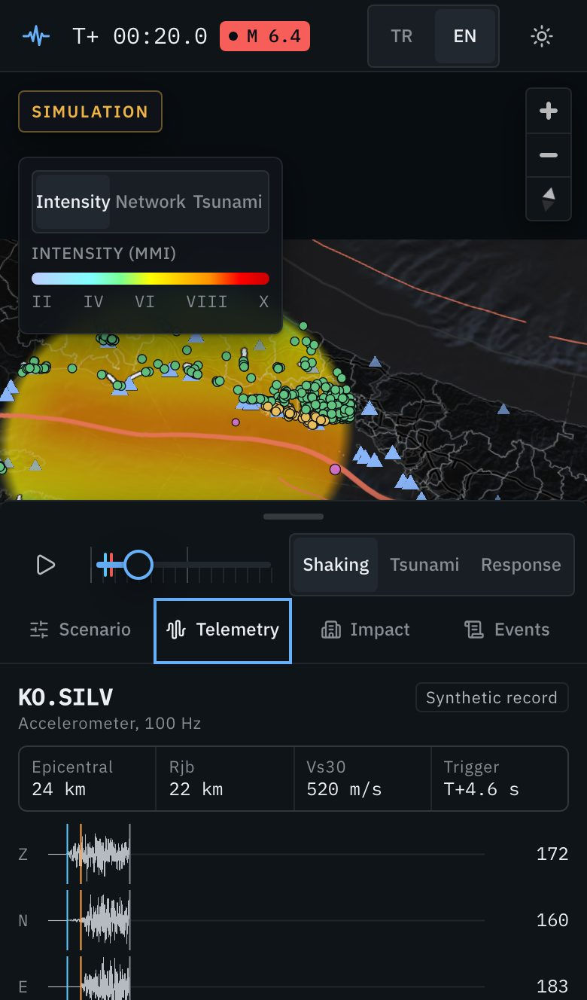

# quakeTrace

Real-time seismology and disaster-response command screen for the Marmara region. A 3D terrain map of İstanbul and the Sea of Marmara shows P and S wavefronts spreading district by district, seismograph stations stream acceleration records, and a scrubbable timeline shows shaking, early-warning times, cell tower load and emergency corridors at every second of a scenario.

Everything runs in the browser. There is no server to operate and no paid service.

> **Simulation, not a warning system.** quakeTrace is an educational and portfolio project. Simulated output is always labeled as simulation; real earthquake data is always labeled with its source. It is not an official early-warning or alerting service.



## What it does

- **Scenarios.** Four expected-earthquake presets on the Main Marmara Fault, an editor for any of the 27 mapped EFSM20 faults (magnitude, hypocentre, depth, seed), and historical replays of 1999 Kocaeli, 2019 Silivri and 2025 Marmara Ereğlisi with USGS parameters.
- **Shaking, second by second.** A finite-fault rupture, P and S wavefronts as curtains of light over 3D terrain, intensity (MMI) filling in as the S wave arrives, and a timeline that plays or scrubs at any speed over three scales: shaking (seconds), tsunami (one hour) and response (72 hours).
- **Telemetry.** Three-component accelerograms at 50 strong-motion stations with STA/LTA triggers; real KOERI records replace the synthetic ones in replays where they exist.
- **Early warning.** Location from the first four stations, a first magnitude estimate, a countdown to S-wave arrival in every district and the blind zone.
- **Impact.** Building damage and night-time fatalities per district, hospitals, fire and police stations, cell-network congestion, fire and hospital response times with emergency corridors, tsunami propagation and a 72-hour aftershock sequence.
- **Live mode.** The last seven days of earthquakes from AFAD, Kandilli, EMSC and USGS, merged and refreshed every minute; any event from M 4 can be simulated.
- **Share and export.** The address bar always holds the running scenario as a readable link. The event log lists every milestone; the results export as GeoJSON, CSV and a printable PDF report.
- **Everywhere.** Desktop, tablet and phone layouts, Turkish and English, dark and light themes, keyboard shortcuts (`?` lists them).

|                                                                                                      |                                                                                                         |
| ---------------------------------------------------------------------------------------------------- | ------------------------------------------------------------------------------------------------------- |
|  |  |
|      |   |

## Science

Every model cites a published source, and the tests check coefficients against reference implementations (OpenQuake, USGS ShakeMap, ObsPy, GeoClaw, Okada's tables). In short: Wells and Coppersmith (1994) rupture scaling, IASP91 travel times, Akkar, Sandıkkaya and Bommer (2014) ground motion with the USGS Vs30 site term, Worden et al. (2012) intensity, the Boore (2003) stochastic method for records, Wu and Zhao (2006) Pd magnitudes, GEM 2025 vulnerability for Türkiye, Hazus bridge fragility, Okada (1985) and linear shallow-water waves, and Reasenberg and Jones (1989) aftershocks. The in-app About dialog and [`memory-bank/simulationModels.md`](memory-bank/simulationModels.md) give the details and the limits.

**Validation against observations.** The modelled median PGA is compared with PGA recorded at KOERI strong-motion stations (geometric mean of the horizontals; [`tests/fixtures/validation`](tests/fixtures/validation)):

| Earthquake                    | Stations | Mean ln(observed / model) | Scatter (σ of ln) |
| ----------------------------- | -------- | ------------------------- | ----------------- |
| 2019 Silivri, Mw 5.7          | 12       | +0.10                     | 0.51              |
| 2025 Marmara Ereğlisi, Mw 6.2 | 43       | +0.09                     | 0.50              |

The target is a mean within ±0.3; the scatter is of the same order as the model's own aleatory variability. Damage is compared with the İBB 2019 İstanbul scenario (district fatality rank correlation 0.77); the model's İstanbul total is about 2.4× lower (the two scenarios assume different ruptures, and the model uses median building-stock assumptions).

## Quick start

Requirements: Node.js 24 or newer.

```sh
npm install
npm run dev
```

Open the printed local URL. The `/api/*` data proxy runs locally inside the dev server; no Cloudflare account is needed for development.

## Scripts

| Command                           | Purpose                                                                    |
| --------------------------------- | -------------------------------------------------------------------------- |
| `npm run dev`                     | Development server with the data proxy                                     |
| `npm run build`                   | Typecheck and production build                                             |
| `npm run preview`                 | Serve the production build locally                                         |
| `npm run typecheck`               | TypeScript across app, worker, tests and configs                           |
| `npm run lint`                    | ESLint, including layer-boundary rules                                     |
| `npm run format` / `format:check` | Prettier                                                                   |
| `npm run test`                    | Unit and integration tests (Vitest)                                        |
| `npm run test:e2e`                | End-to-end tests on desktop, tablet and phone viewports (Playwright)       |
| `npm run cf-typegen`              | Regenerate Cloudflare Worker runtime types after changing `wrangler.jsonc` |
| `npm run deploy`                  | Build and deploy to Cloudflare Workers                                     |

## Architecture

- **Client:** React, TypeScript and Vite. MapLibre GL renders the basemap and 3D terrain; deck.gl renders data layers on the GPU. The physics engine runs in Web Workers.
- **Data proxy:** a small Cloudflare Worker (`worker/`) forwards an allowlist of upstream services that lack CORS or HTTPS (AFAD, Kandilli, KOERI FDSN) and adds caching headers. Static assets are served by Cloudflare Workers static assets.
- **Data preparation:** offline Python scripts (`pipeline/`, developers only) prepare datasets that are committed to `public/data/`.

Project rules, architecture, design system and data sources are documented in [`AGENTS.md`](AGENTS.md) and [`memory-bank/`](memory-bank/).

## Deploying for free

Cloudflare Workers' free plan serves the static site and the proxy.

1. Create a free Cloudflare account.
2. Either connect this GitHub repository in the Cloudflare dashboard (Workers & Pages → Create → Import a repository, build command `npm run build`, deploy command `npx wrangler deploy`), or deploy from your machine:

   ```sh
   npx wrangler login
   npm run deploy
   ```

## Data and attribution

- Basemap: [OpenFreeMap](https://openfreemap.org), © [OpenMapTiles](https://openmaptiles.org), data © [OpenStreetMap contributors](https://www.openstreetmap.org/copyright)
- Terrain: [AWS Terrain Tiles](https://registry.opendata.aws/terrain-tiles/), © Mapzen and [contributors](https://github.com/tilezen/joerd/blob/master/docs/attribution.md)
- Earthquake data (live mode): AFAD, Boğaziçi University Kandilli Observatory (KOERI), EMSC, USGS

Prepared datasets: faults (EFSM20), vulnerability (GEM Global Vulnerability Model, CC BY-NC-SA 4.0, non-commercial), districts (geoBoundaries), population (WorldPop), Vs30 (USGS), elevation (Copernicus DEM), building counts (İBB), seismic stations (KOERI, EIDA), bathymetry (EMODnet), infrastructure and roads (OpenStreetMap). The full list with licenses is generated into [`public/data/ATTRIBUTION.md`](public/data/ATTRIBUTION.md); sources and processing are described in [`memory-bank/dataSources.md`](memory-bank/dataSources.md).

### Rebuilding the data (developers only)

The datasets are committed, so running the app never needs this. To rebuild them, install [uv](https://docs.astral.sh/uv/) and run from `pipeline/`:

```sh
uv sync
uv run quaketrace-pipeline build --all
```

A full build downloads about 1.3 GB into `pipeline/.cache/`. Cell sites need a free [OpenCelliD](https://opencellid.org) key in `pipeline/.env` (see `pipeline/.env.example`).

## License

Code is released under the [MIT License](LICENSE). Datasets keep their own licenses.
